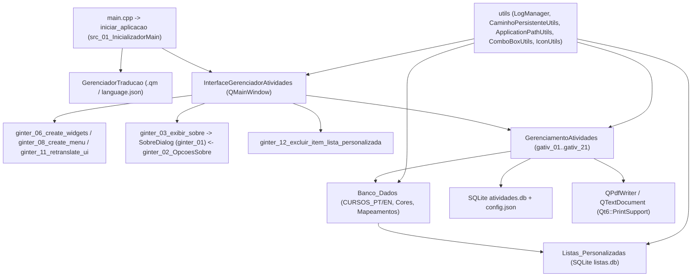

# Arquitetura do Sistema / System Architecture — AGENDA DE AVALIAÇÕES ACADÊMICAS

<p align="center">
  <b>Selecione o idioma / Select language:</b><br>
  <a href="#ptbr">🇧🇷 Português (BR)</a> | <a href="#enus">🇺🇸 English (US)</a>
</p>

---

## <a id="ptbr"></a>🇧🇷 Português (BR)

<details>
<summary>Clique para expandir / recolher a arquitetura em português</summary><br>

# AGENDA DE AVALIAÇÕES ACADÊMICAS — Arquitetura de Sistema e Especificações Técnicas

**Versão:** `2026.11.22.0`  
**Data:** `22 de novembro de 2026`  
**Padrão:** C++23 | Qt 6.12.0 (`Core`, `Gui`, `Widgets`, `Sql`, `PrintSupport`, `LinguistTools`, `Test`) | SQLite (`QSQLITE`)  
**Plataforma Alvo:** Windows 11 / Windows 10 x64 (MSVC `14.52.37025` & MinGW-w64 GCC `15.1.0`)  
**Autor:** Fernando Nillsson Cidade  

---

## 1. Visão Geral em Camadas e Fluxo de Dados

A aplicação é estruturada como uma biblioteca estática modular (`AgendaCore`) ligada pelo executável desktop nativo (`AgendaAvaliacoesAcademicas.exe`) e pelas 9 suítes de testes automatizados em `tests/`. Todo o pipeline executa localmente no dispositivo do usuário:



---

## 2. Organização Modular (`source/`)

### 2.1. Persistência e Catálogos (`source/BancoDeDados/`)
- **`DicionariosListasBancoDeDados/`**:
  - `CURSOS_PT` / `CURSOS_EN`: hierarquia imutável `EstruturaCursos -> CursoCurricular -> EmentaCurricular -> SemestreCurricular -> QStringList disciplinas`.
  - `mapeamento_cursos`, `mapeamento_ementas`, `mapeamento_semestres`: traduções bidirecionais de identificadores curriculares entre `pt_BR` e `en_US`.
  - `dicionario_de_cores` (24 paletas hex `#RRGGBB` nomeadas de `1ª Coloracao Disciplina` a `24ª Coloracao Disciplina`) e `dicionario_disciplinas` (múltiplas disciplinas associadas a cada grupo cromático).
  - `lista_cursos_{pt_BR,en_US}`, `lista_turmas_{pt_BR,en_US}`, `lista_avaliacoes_{pt_BR,en_US}`.
- **`Listas_Personalizadas`**: gerencia `%LOCALAPPDATA%\AgendaAvaliacoesAcademicas\listas.db` via conexões nomeadas únicas (`QUuid`) e limpeza RAII (`DbHandle::~DbHandle`). Opera **7 tabelas SQLite**:
  1. `lista_cursos` (`UNIQUE(idioma, valor_normalizado)`)
  2. `lista_ementas` (`UNIQUE(idioma, curso_normalizado, valor_normalizado)`)
  3. `lista_semestres` (`UNIQUE(idioma, curso_normalizado, ementa_normalizada, valor_normalizado)`)
  4. `lista_disciplinas` (`UNIQUE(idioma, curso_normalizado, ementa_normalizada, semestre_normalizado, valor_normalizado)`)
  5. `lista_turmas` (`UNIQUE(idioma, valor_normalizado)`)
  6. `lista_tipos_atividade` (`UNIQUE(idioma, valor_normalizado)`)
  7. `lista_sequencias_atividade` (`UNIQUE(idioma, valor_normalizado)`)
- **`Banco_Dados`**: mescla listas estáticas e personalizadas (`_mesclar_listas` case-insensitive mantendo ordem), resolve cascades por idioma (`obter_ementas`, `obter_semestres`, `obter_disciplinas`) e mapeia cores por código `([A-Z]{1,3}\d{3,4})$` ou nome completo (`obter_cor_por_nome`).

### 2.2. Gerenciamento de Atividades (`source/GerenciamentoAtividades/`)
- Classe `GerenciamentoAtividades` dividida em `gativ_01`..`gativ_21`:
  - **Tabela `atividades` em `atividades.db`**:
    ```sql
    CREATE TABLE IF NOT EXISTS atividades (
        id INTEGER PRIMARY KEY AUTOINCREMENT,
        data TEXT NOT NULL,
        tipo TEXT NOT NULL,
        sequencia TEXT NOT NULL,
        nome TEXT NOT NULL,
        turma TEXT NOT NULL
    )
    ```
  - **Ordenação Cronológica & Renderização Segura (`gativ_11_update_textbox.cpp`)**: ordena em memória por `QDate::fromString(a.data, "dd/MM/yyyy")`, aplica `toHtmlEscaped()` em todos os campos e renderiza sublinhado colorido (`modo_cores == "coloridas"`) ou padrão do sistema (`modo_cores == "preto"`).
  - **Configuração de Cores (`config.json`)**: persiste `"modo_cores"` (`"preto"` ou `"coloridas"`).
  - **Exportação PDF (`gativ_10_exportar_para_pdf.cpp`)**: usa `QPdfWriter` em `QPageSize::Letter` com margens de `10 mm` (`QPageLayout::Millimeter`) e `QTextDocument::print(&writer)`.

### 2.3. Interface Gráfica, Internacionalização & Utilitários
- **`InterfaceGerenciadorAtividades` (`source/GerenciamentoInterfaceGrafica/`)**: `QMainWindow` com guardas anti-reentrância em cascata (`_atualizando_ementa`, `_atualizando_semestre`, `_atualizando_disciplinas`), menus dinâmicos de exclusão de itens personalizados (`popular_menu_itens_personalizados`), troca ao vivo de idioma (`change_language`) e cores (`change_color_mode`), e diálogo modal `SobreDialog` com 6 abas.
- **`GerenciadorTraducao` (`source/language/`)**: gerencia `language.json` e instala `QTranslator` a partir de `manager_compression_<idioma>.qm` compilados de `.ts` pelo alvo CMake `AgendaTranslations` via `Qt6::lrelease`.
- **`utils/`**: `CaminhoPersistenteUtils` (resolução `LOCALAPPDATA/AgendaAvaliacoesAcademicas`), `ApplicationPathUtils` / `IconUtils` (descoberta portátil de `source/assets`), `ComboBoxUtils` (`QSignalBlocker`, deduplicação case-insensitive), `LogManager` (`QMutex` + rotação para no máximo `kMaxLogFiles = 10` arquivos `file_agenda_*.log`) e `TrialManager` (`trial_info.json` + leitura/gravação auxiliar).

---

## 3. Arquitetura de Build, Distribuição Externa Ultra-Limpa e Suíte de Testes

- **`CMakeLists.txt` + `cmake/*.cmake` + `CMakePresets.json`:**
  - Módulos reutilizáveis em `cmake/`: `AgendaToolchain.cmake` (detecção multi-configuração Qt 6.12.0 e runtimes CRT/MinGW), `AgendaTranslations.cmake` (`AgendaTranslations` via `lrelease`), `AgendaDeployment.cmake` (implantação limpa e `DeployAgenda`), `AgendaFormatting.cmake` (perfil C++23 em substituição a `.clang-format`, com alvos `AgendaFormat`/`AgendaFormatCheck`), `AgendaTaskRunner.cmake` (orquestração de builds, mocks unificados e suítes sem PowerShell) e `AgendaClearBuilds.cmake`.
  - `AgendaCore` (`STATIC`): alvo central compilado em C++23; `AgendaAvaliacoesAcademicas` (`WIN32`) incorpora `source/resources.rc` (`assets/icones/ReviewsManager.ico`).
  - `DeployAgenda` gera `../AgendaAvaliacoesAcademicas_{msvc,mingw}` (configurável via `AGENDA_DEPLOY_DIR`) executando `windeployqt` com filtros estritos (`--skip-plugin-types`, `--exclude-plugins`), copiando apenas as 5 DLLs app-local do CRT MSVC (ou as 3 DLLs do MinGW GCC `15.1.0`), os 13 assets de runtime listados em `AGENDA_RUNTIME_ASSETS` e os 2 `.qm`, consumidos pelos instaladores Inno Setup em `library/Agenda_Avaliacoes_Academicas*.iss`.
  - `mocks/CMakeLists.txt`: compila `VersionEditor.exe` e `CompileTranslations.exe` de forma unificada em `builds/build_MOCKS_{msvc,mingw}`.
  - `AGENDA_BUILD_TESTS=ON` (presets `suite-msvc` -> `builds/build_suite_msvc` e `suite-mingw` -> `builds/build_suite_mingw`): compila **9 alvos CTest/QtTest** em `tests/` contra `AgendaCore` e `Qt6::Test`, copiando os assets e `.qm` apenas localmente no diretório de build dos testes (**sem** gerar distribuição externa).

</details>

---

## <a id="enus"></a>🇺🇸 English (US)

<details>
<summary>Click to expand / collapse architecture in English</summary><br>

# ACADEMIC EVALUATION SCHEDULE — System Architecture & Technical Specifications

**Version:** `2026.11.22.0`  
**Date:** `November 22, 2026`  
**Standards:** C++23 | Qt 6.12.0 (`Core`, `Gui`, `Widgets`, `Sql`, `PrintSupport`, `LinguistTools`, `Test`) | SQLite (`QSQLITE`)  
**Target Platform:** Windows 11 / Windows 10 x64 (MSVC `14.52.37025` & MinGW-w64 GCC `15.1.0`)  

## 1. Layered Design

The codebase compiles cleanly into a shared static library target (`AgendaCore`) linked by both the desktop binary (`AgendaAvaliacoesAcademicas.exe`) and the 9 modular test executables under `tests/`:
1. **Persistence & Catalogs (`BancoDeDados`):** Built-in `CURSOS_PT`/`CURSOS_EN` curricula, 24-color code/subject dictionaries, and language-scoped SQLite storage across 7 normalized tables in `listas.db`.
2. **Domain Logic (`GerenciamentoAtividades`):** SQLite `atividades.db` CRUD, chronological sorting (`dd/MM/yyyy`), HTML-escaped rich rendering, `config.json` color preference persistence, batch/detail modal editors, and `QPdfWriter` output (`QPageSize::Letter`, `10 mm` margins).
3. **GUI & i18n (`GerenciamentoInterfaceGrafica`, `language`):** Reentrancy-guarded cascading dropdowns, runtime translation (`GerenciadorTraducao` + `.qm`), live monochrome/colorful switching, and the 6-tab `SobreDialog`.
4. **Utilities (`utils/`):** Portable `source/assets` lookup, `QSignalBlocker` combo helpers, mutex-protected rotating `LogManager` (`kMaxLogFiles = 10`), and persistence helpers.
5. **Modular CMake Build, Clean Deployment & Suite Pipeline:** Shared `cmake/*.cmake` modules (`AgendaToolchain`, `AgendaTranslations`, `AgendaDeployment`, `AgendaFormatting`, `AgendaTaskRunner`, `AgendaClearBuilds`), `source/resources.rc` icon embedding, Inno Setup packaging scripts under `library/`, unified auxiliary builds in `builds/build_MOCKS_{msvc,mingw}`, and `qt-msvc`/`qt-mingw` vs. `suite-msvc`/`suite-mingw` separation producing zero external deployment during tests.

</details>
